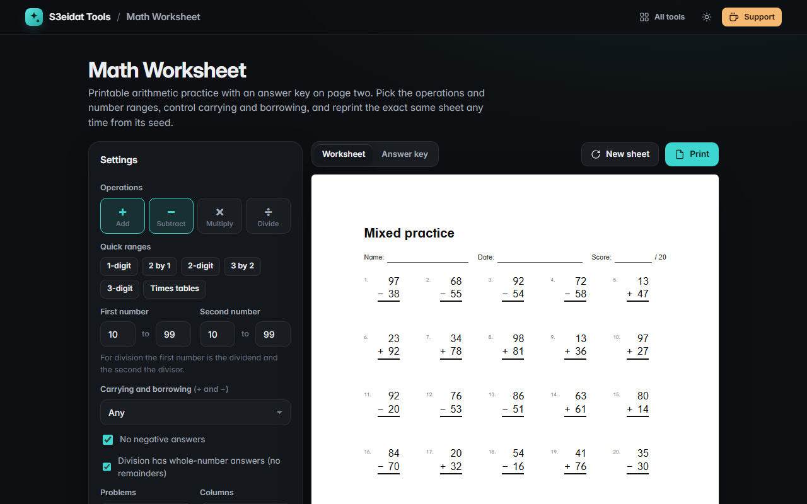

# Math Worksheet

> Printable arithmetic worksheets with answer keys. Free, private, and it runs entirely in your browser.

### ▶ [Open Math Worksheet](https://s3eidat.github.io/math-worksheet/)



## Features

- **Addition, subtraction, multiplication, division** or any mix (mixed sheets are balanced evenly)
- Number **ranges** for each operand, with quick presets (1-digit, 2-digit, 3 by 2, times tables)
- **Carrying and borrowing**: any, none, or every problem regroups
- **No negative answers** and **whole-number division** (or division with remainders)
- 1 to 120 problems in 1 to 6 **columns**, **vertical** (stacked, with long-division brackets) or **horizontal** layout
- **Name, date and score** line, your own title
- **Western or Arabic-Indic digits** (١٢٣) with Arabic labels
- **Seed**: every sheet has a code; type it again to reprint the exact same sheet
- **Answer key** on page 2, and **A4 or Letter** printing

## Privacy

Nothing leaves your device. There is no server, no account, no analytics.
The page ships with a strict Content-Security-Policy (`connect-src 'self'`), so the browser
itself blocks any attempt to send data anywhere. Your settings are remembered in local storage.

## Run it yourself

It's plain HTML, CSS and JavaScript with no build step:

```bash
git clone https://github.com/s3eidat/math-worksheet
cd math-worksheet
python -m http.server 8000
```

Then open http://localhost:8000.

## Support

If this saved you time, **[buy me a coffee ☕](https://s3eidat.github.io/coffee/)**. It keeps every tool free.

---

Part of **[S3eidat Tools](https://s3eidat.github.io/)**: 100+ free, private tools that run in your browser. MIT licensed.
